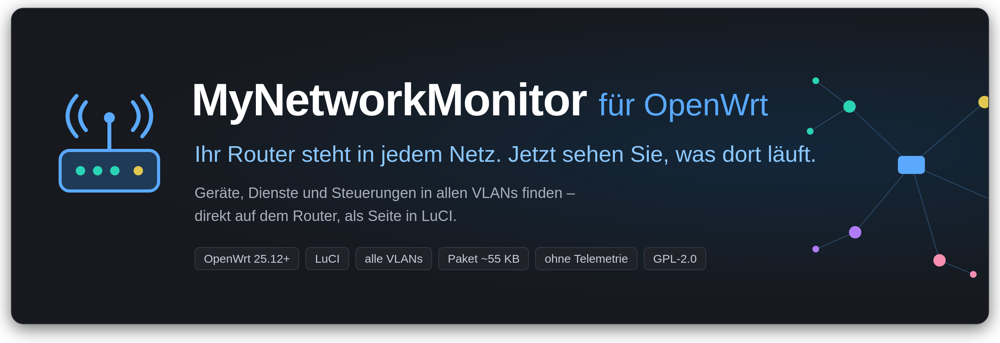
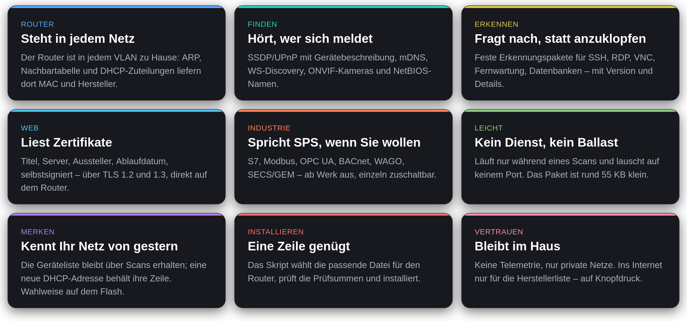
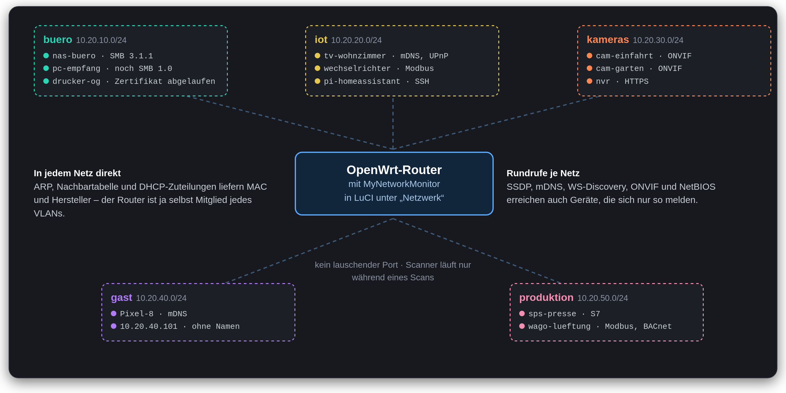
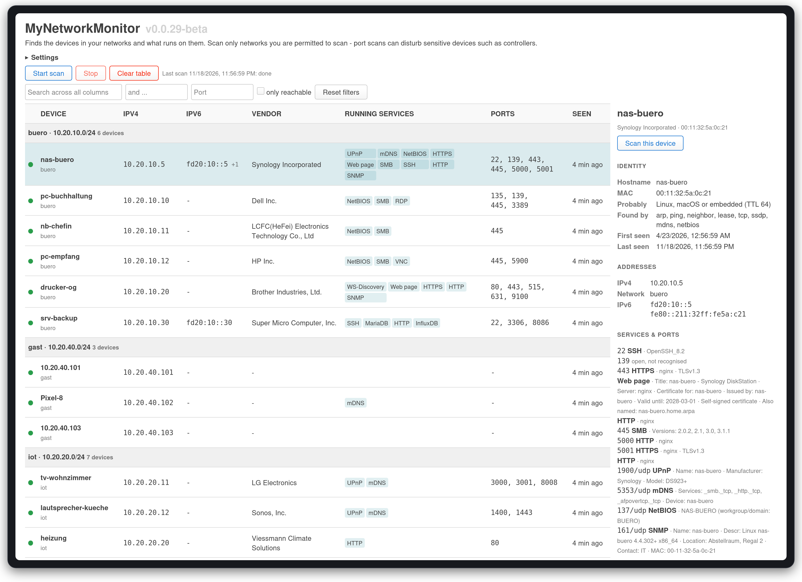
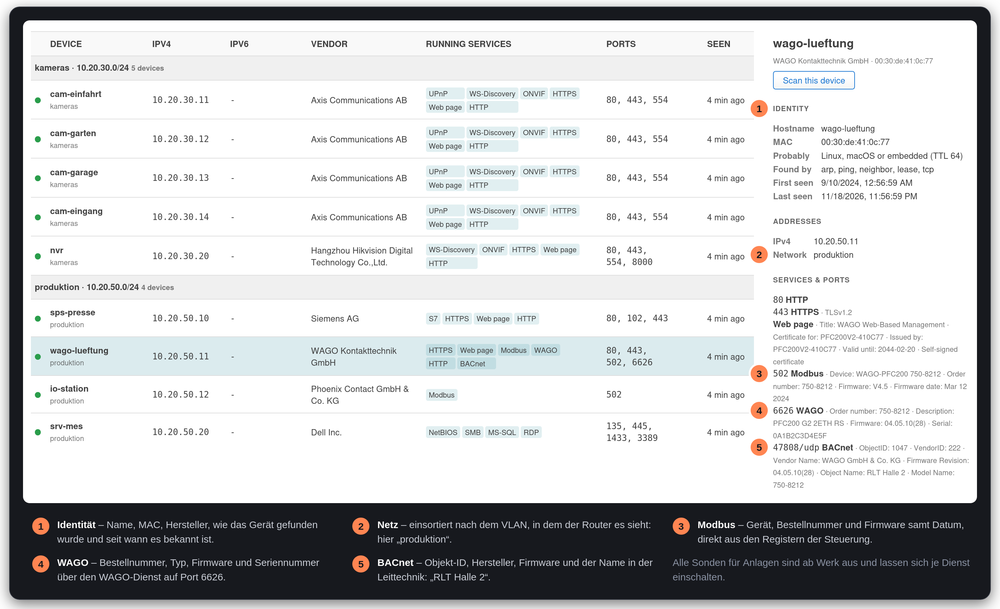
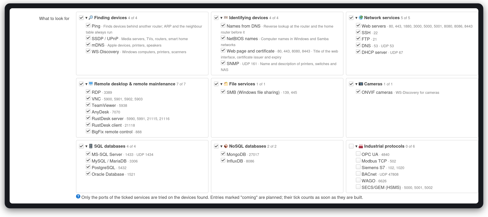

<p align="center">
  
</p>

<p align="center">
  
  
  
  
  
</p>

<p align="center">Vom NAS im Büro bis zur SPS in der Halle – in allen VLANs, direkt auf dem Router.</p>

---

## Der beste Platz für einen Netzwerk-Scanner? Ihr Router.

Er hängt in jedem Netz, kennt jede MAC-Adresse aus ARP, Nachbartabelle und DHCP und erreicht auch die Geräte, die
sich nur auf Rundrufe melden – ohne dass Sie irgendwo einen Rechner aufstellen, einen Agenten verteilen oder Ports
zwischen den VLANs öffnen. MyNetworkMonitor für OpenWrt macht daraus eine Seite in LuCI: Sie wählen die Netze, starten
den Scan und sehen, welche Geräte dort stehen, welche Dienste laufen und was diese Dienste über sich verraten. Ohne
Cloud, ohne Konto, ohne Dauerbetrieb.

<p align="center">
  
</p>

---

## Ein Router in jedem Netz

<p align="center">
  
</p>

<p align="center"><sub>Alle Bilder in doppelter Auflösung – zum Vergrößern anklicken.</sub></p>

**Was Sie sehen:** einen Router mit fünf VLANs – Büro, IoT, Kameras, Gäste und Produktion. Weil der Router selbst in
jedem dieser Netze steht, bekommt der Scanner MAC-Adresse und Hersteller jedes Geräts direkt aus ARP, Nachbartabelle
und DHCP-Zuteilungen – in jedem seiner Netze, nicht nur in einem. Rundrufe über SSDP, mDNS, WS-Discovery, ONVIF und
NetBIOS gehen in jedes Netz einzeln und finden auch Geräte, die auf keinen Ping antworten. Das Scanprogramm läuft nur,
solange ein Scan läuft, und lauscht auf keinem Port.

---

## Alles auf einen Blick

<p align="center">
  
</p>

**Was Sie sehen:** die Seite in LuCI nach einem Scan – 25 Geräte in fünf Netzen, nach VLAN gruppiert. Jede Zeile ein
Gerät, mit Name, IPv4- und IPv6-Adresse, Hersteller aus der MAC-Adresse, den erkannten Diensten als Marken und den
offenen Ports. Rechts die Details des ausgewählten NAS: woher der Router das Gerät kennt, seit wann, und jeder Dienst
mit dem, was er preisgibt – die SSH-Software, die SMB-Versionen, das Zertifikat der Weboberfläche mit Aussteller und
Ablaufdatum, Name, Beschreibung und Standort aus SNMP, Hersteller und Modell aus UPnP, die mDNS-Dienste und der
NetBIOS-Name mit Arbeitsgruppe. Darüber suchen Sie in allen Spalten, filtern nach Port oder blenden aus, was beim
letzten Scan nicht geantwortet hat.

---

## Er klopft nicht nur an – er fragt nach

Ein gewöhnlicher Portscan meldet „offen“ oder „zu“. MyNetworkMonitor schickt jedem Dienst die erste Nachricht
**in dessen eigener Sprache** – eine SMB-Verhandlung, eine S7-Verbindung, die Modbus-Geräteidentifikation, ein
BACnet-ReadProperty, die Frage an den WAGO-Dienst – und die Anwendung antwortet von sich aus: mit Produkt, Version,
Bestellnummer, Firmware. Diese Erkennungspakete sind für jeden Dienst gezielt gebaut und an echten Geräten erprobt.

### Was eine Lüftungssteuerung alles verrät

<p align="center">
  
</p>

**Was Sie sehen:** die Netze „kameras“ mit vier ONVIF-Kameras und einem Rekorder und „produktion“ mit einer
S7-Steuerung, einer Modbus-Station und einem MES-Server. Ausgewählt ist die WAGO-Steuerung der Lüftung. Ohne
Zugangsdaten und ohne Engineering-Software liest der Router aus ihr Bestellnummer, Typ, Firmware und Seriennummer
über den WAGO-Dienst, Gerät, Bestellnummer und Firmware samt Datum aus den Modbus-Registern und über BACnet den Namen,
unter dem die Anlage in der Gebäudeleittechnik geführt wird. Die Nummern führen durch die Abschnitte.

### Sie bestimmen, wonach gesucht wird

<p align="center">
  
</p>

**Was Sie sehen:** die neun Gruppen, aus denen Sie den Scan zusammenstellen – Geräte finden, Geräte erkennen,
Netzwerkdienste, Fernwartung (RDP, VNC, TeamViewer, AnyDesk, RustDesk und mehr), Dateidienste, Kameras, SQL- und
NoSQL-Datenbanken und Industrieprotokolle (OPC UA, Modbus TCP, Siemens S7, BACnet, WAGO, SECS/GEM). Versucht werden nur
die Ports der angekreuzten Dienste. Die Industrieprotokolle sind ab Werk aus: Sie schalten sie gezielt dort ein, wo
Sie wissen, dass die Steuerungen eine Abfrage vertragen.

---

## Leicht genug für jeden Router

- **Kein Dienst im Hintergrund:** Das Scanprogramm startet mit dem Scan und endet mit ihm. Es lauscht auf keinem Port.
- **Klein:** Das Scanprogramm ist rund 55 KB groß, die Seite für LuCI rund 19 KB. Es braucht nur `luci-base`,
  `rpcd-mod-ucode` und `libmbedtls`, die auf einem OpenWrt mit Weboberfläche schon da sind.
- **Schont den Flash:** Geräteliste und Herstellerliste liegen ab Werk im Arbeitsspeicher (`/tmp`). Mit „Keep after
  reboot“ bleiben sie auch über einen Neustart erhalten.
- **Merkt sich Ihr Netz:** Jeder Scan ergänzt die Liste, statt sie zu ersetzen. Bekommt ein Gerät per DHCP eine neue
  Adresse, behält es seine Zeile.
- **Bleibt im Haus:** keine Telemetrie, nur private Netze, nie Adressen im Internet. Ins Internet geht es nur, wenn Sie
  die Herstellerliste laden (von www.wireshark.org).

---

## Installation

Auf dem Router per SSH eine Zeile – das Skript wählt die Datei, die zur Prozessorart passt, nimmt die neueste Version,
prüft die Prüfsummen und installiert beide Pakete:

```sh
wget -O - https://raw.githubusercontent.com/systemswap/MyNetworkMonitor_OpenWRT_Plugin/main/packaging/install.sh | sh
```

Danach steht die Seite in LuCI unter *Netzwerk → MyNetworkMonitor*.

- **Ohne Internet am Router:** `install.sh`, `SHA256SUMS` und die beiden Pakete aus dem [Release](../../releases)
  nach `/tmp` kopieren (`scp -O …`) und `sh /tmp/install.sh` starten.
- **Nicht über *System → Software → Paket hochladen…*:** Die Pakete sind nicht von OpenWrt signiert, und LuCI gibt
  `--allow-untrusted` nicht weiter – die Installation bricht mit Fehlercode 99 ab.
- **Prozessorarten:** zunächst `aarch64_cortex-a53` (z. B. Linksys MX4200, Raspberry Pi 3 mit 64 Bit),
  `arm_cortex-a7_neon-vfpv4` (Raspberry Pi 2/3 mit 32 Bit), `aarch64_cortex-a72` (Raspberry Pi 4) und
  `aarch64_cortex-a76` (Raspberry Pi 5); weitere folgen nach den ersten Tests. Welche Datei zu welchem Gerät passt:
  `packaging/GERAETE.html`. Schritt für Schritt: `packaging/ANLEITUNG.txt`.

> **Bitte nur Netze scannen, für die Sie die Erlaubnis haben.** Portscans und Abfragen können empfindliche Geräte wie
> Steuerungen stören – in Produktionsnetzen erst in einem ruhigen Moment und mit Rücksprache.

**Stand:** Beta – benutzbar.

<details>
<summary><b>Aufbau</b></summary>

- `mynetworkmonitor-scan` – das Scanprogramm (C, mbedTLS). Es läuft nur, wenn Sie in LuCI einen Scan starten.
- `luci-app-mynetworkmonitor` – die Seite in LuCI und ein kleines Backend für rpcd, das die Geräteliste führt.

Entscheidungen und Aufbau im Einzelnen: `docs/Architektur.md`.
</details>

---

## Lizenz

GNU General Public License, Version 2 (`LICENSE`). Fremde Bestandteile und ihre Lizenzen: `THIRD-PARTY-NOTICES.md`.

Alle Namen, Adressen und Geräte auf den Bildern sind erfunden. Mit KI-Unterstützung entwickelt.
